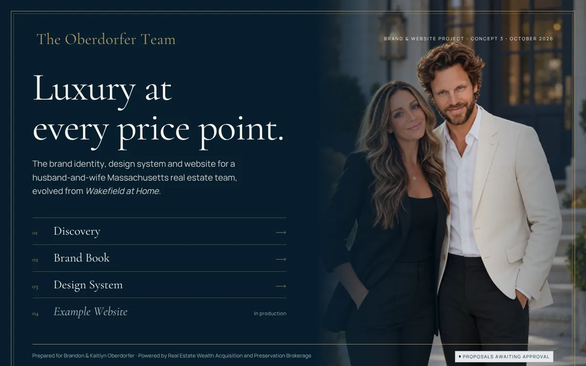
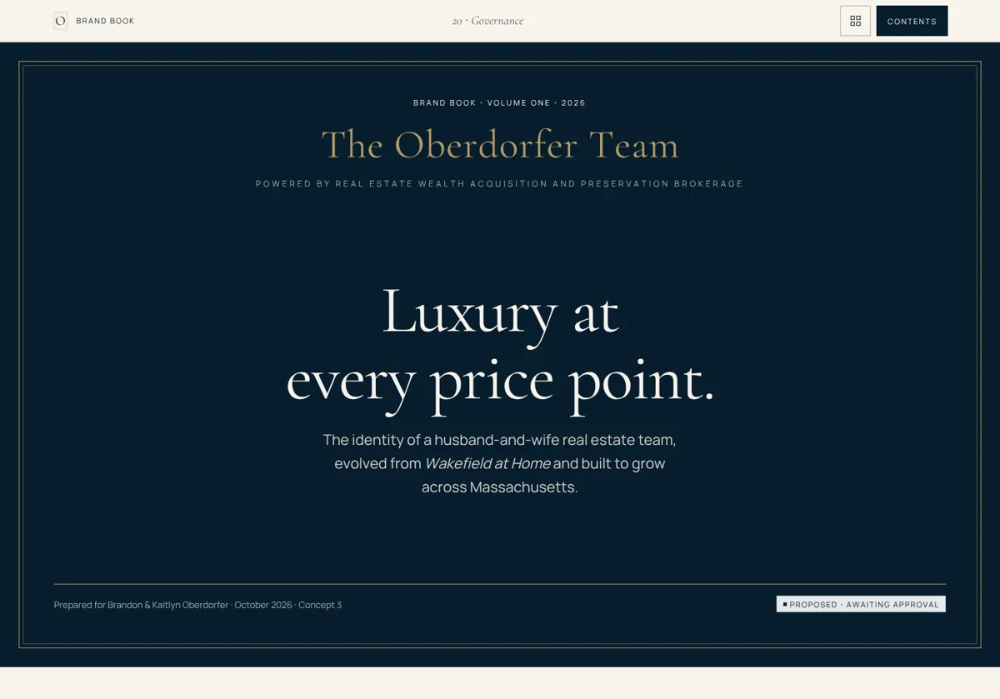
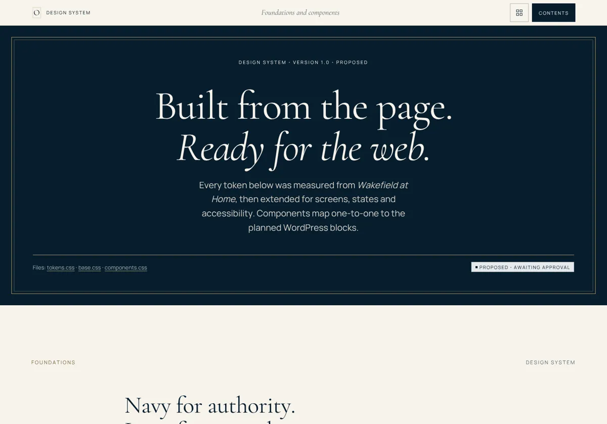
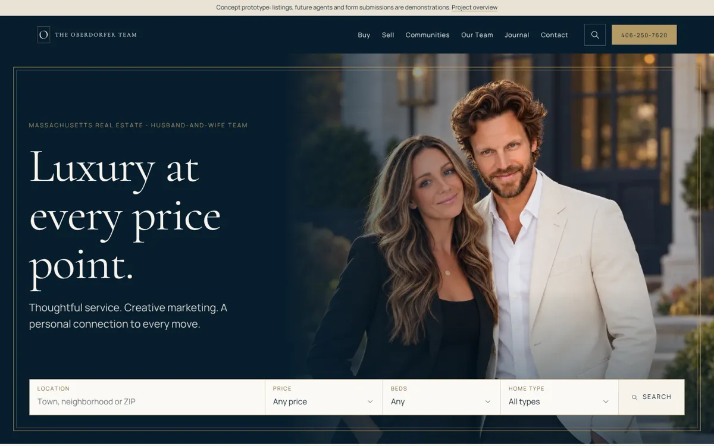
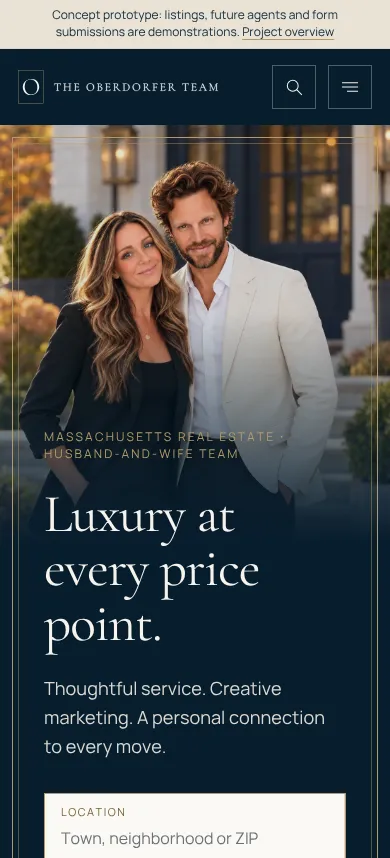

# The Oberdorfer Team: Brand, Design System & Website (Concept 3)

**Luxury at every price point.**

This repository holds the brand identity, brand book, design system and example website for **The Oberdorfer Team**. The team is a husband-and-wife Massachusetts real estate team, led by Brandon and Kaitlyn Oberdorfer, operating under **REWAP Brokerage LLC**.

The visual direction evolves the team's print publication, *Wakefield at Home*, Fall 2026, into one system for the web, print, signage and social media.



> **Status:** concept for client review, October 2026.
>
> - All listings, future agents, office details and form submissions are **demonstrations**.
> - Proposals are marked *Proposed · awaiting approval*.
> - Open items are listed under [Open items](#open-items).

---

## Contents

- [View it](#view-it)
- [Deliverables](#deliverables)
- [The example website](#the-example-website)
- [Brand at a glance](#brand-at-a-glance)
- [Repository structure](#repository-structure)
- [Working on it](#working-on-it)
- [Content integrity](#content-integrity)
- [Open items](#open-items)
- [Roadmap](#roadmap)
- [Project files for Claude and design tooling](#project-files-for-claude-and-design-tooling)
- [Credits and licenses](#credits-and-licenses)

---

## View it

Everything is online at **https://cptnope.github.io/The-Oberdorfer-Team-Concept-3/**.

Each push to `main` deploys automatically through [`.github/workflows/pages.yml`](.github/workflows/pages.yml) (Settings → Pages → Source: *GitHub Actions*). The workflow publishes only what visitors need, about 5 MB:

- `index.html`, `assets/`, `discovery/`, `brand-book/`, `design-system/` and `site/` are published.
- The print PDF, tools, docs and Markdown files stay in the repository only.

It can also be run by hand from the Actions tab.

| | Live (GitHub Pages) | In the repo |
|---|---|---|
| Project overview | [Open](https://cptnope.github.io/The-Oberdorfer-Team-Concept-3/) | [`index.html`](index.html) |
| Discovery | [Open](https://cptnope.github.io/The-Oberdorfer-Team-Concept-3/discovery/) | [`discovery/`](discovery/index.html) |
| Brand book | [Open](https://cptnope.github.io/The-Oberdorfer-Team-Concept-3/brand-book/) | [`brand-book/`](brand-book/index.html) |
| Design system | [Open](https://cptnope.github.io/The-Oberdorfer-Team-Concept-3/design-system/) | [`design-system/`](design-system/index.html) |
| Example website | [Open](https://cptnope.github.io/The-Oberdorfer-Team-Concept-3/site/) | [`site/`](site/index.html) |

To view it locally:

```sh
python3 -m http.server 8765
# then open http://localhost:8765/
```

The pages are plain HTML, CSS and JavaScript. The committed files are ready to serve, so no build is needed to view them.

---

## Deliverables

The numbers follow Phase 19 of the [creative brief](source/creative-brief.md).

| # | Deliverable | Where | Status |
|---|---|---|---|
| 1 | PDF design audit | [Discovery › Page by page](discovery/index.html#pages), [Systems](discovery/index.html#systems), [Content inventory](discovery/index.html#content) | ✅ Ready |
| 2 | Brand strategy | [Brand book ch. 02–08](brand-book/index.html#story): story, mission and vision, positioning, audiences, values, voice, messaging | ✅ Ready for review |
| 3 | Three visual directions | [Discovery › Three directions](discovery/index.html#directions). **A + B chosen** on Oct 15, 2026 | ✅ Decided |
| 4 | Complete brand book | [Brand book](brand-book/index.html): 20 chapters with mockups | ✅ Ready for review |
| 5 | Design tokens and component library | [Design system](design-system/index.html) · [`tokens.css`](assets/css/tokens.css) · [`components.css`](assets/css/components.css) | ✅ Ready for review |
| 6 | Sitemap and user journeys | [Brand book › Website](brand-book/index.html#website) · [Audiences](brand-book/index.html#audience) · the [site](site/index.html) itself | ✅ Ready for review |
| 7 | High-fidelity website design | [Example website](site/index.html), desktop and mobile | ✅ Ready for review |
| 8 | Working prototype | [Example website](site/index.html): working search, filters, saved homes, forms and tabs | ✅ Ready for review |
| 9 | WordPress and IDX architecture | Block mapping in [Design system › WordPress](design-system/index.html#wordpress). Full document still to come | 🔜 Next |
| 10 | Client review and production checklist | Open items in [Brand book › Governance](brand-book/index.html#governance). Full checklist still to come | 🔜 Next |

### Brand book chapters

| | | | |
|---|---|---|---|
| 01 [Introduction](brand-book/index.html#intro) | 06 [Values](brand-book/index.html#values) | 11 [Typography](brand-book/index.html#typography) | 16 [Social media](brand-book/index.html#social) |
| 02 [Brand story](brand-book/index.html#story) | 07 [Tone of voice](brand-book/index.html#voice) | 12 [Photography](brand-book/index.html#photography) | 17 [Print and publications](brand-book/index.html#print) |
| 03 [Mission and vision](brand-book/index.html#mission) | 08 [Messaging](brand-book/index.html#messaging) | 13 [Layout](brand-book/index.html#layout) | 18 [Signage](brand-book/index.html#signage) |
| 04 [Positioning](brand-book/index.html#positioning) | 09 [Logo system](brand-book/index.html#logo) | 14 [Design tokens](brand-book/index.html#tokens) | 19 [Agent materials](brand-book/index.html#agents) |
| 05 [Audiences](brand-book/index.html#audience) | 10 [Color](brand-book/index.html#color) | 15 [Website language](brand-book/index.html#website) | 20 [Governance](brand-book/index.html#governance) |



### Design system chapters

[Color tokens](design-system/index.html#color) · [Type scale](design-system/index.html#type) · [Space, grid and lines](design-system/index.html#space) · [Icons](design-system/index.html#icons) · [Buttons](design-system/index.html#buttons) · [Navigation](design-system/index.html#navigation) · [Editorial hero](design-system/index.html#hero) · [Property search](design-system/index.html#search) · [Cards](design-system/index.html#cards) · [Market statistics](design-system/index.html#market) · [Forms](design-system/index.html#forms) · [Editorial content](design-system/index.html#editorial) · [Lead capture, office, map](design-system/index.html#conversion) · [Footer and attribution](design-system/index.html#footer) · [Motion and accessibility](design-system/index.html#motion) · [WordPress mapping](design-system/index.html#wordpress)



---

## The example website

The site has 19 responsive pages. They are generated by [`tools/build_site.py`](tools/build_site.py) and run on clearly labeled demo data.

| Page | Path | Highlights |
|---|---|---|
| Home | [`site/`](site/index.html) | Cover hero with search, team introduction, featured homes, buy and sell paths, communities, market snapshot, journal |
| Buy | [`site/buy/`](site/buy/index.html) | Working search (also `?q=&price=&beds=&type=`), quick filters, sort, saved homes, buying steps, buyer form |
| Listing (×6) | [`site/buy/demo-residence-one/`](site/buy/demo-residence-one/index.html) … | Gallery, facts, details, map plate, showing request, MLS attribution placeholders |
| Sell | [`site/sell/`](site/sell/index.html) | Three decisions, the 30-minute fall edit, marketing, FAQ (FAQPage JSON-LD), market review form |
| Market insight | [`site/market/`](site/market/index.html) | Wakefield figures with source, period and geography |
| Communities | [`site/communities/`](site/communities/index.html) | Massachusetts hub. Guides are published one at a time and never generated in bulk |
| Wakefield guide | [`site/communities/wakefield/`](site/communities/wakefield/index.html) | Community template: rhythm, history, market, season, nearby homes |
| Our Team | [`site/team/`](site/team/index.html) | Filterable directory, plus open seats that link to recruiting |
| Agent profile | [`site/agents/brandon-kaitlyn-oberdorfer/`](site/agents/brandon-kaitlyn-oberdorfer/index.html) | Template for `/agents/agent-name/` |
| Journal | [`site/journal/`](site/journal/index.html) | Feature article, category filter, *At Home* archive with PDF download |
| Article | [`site/journal/the-best-plans-are-close-to-home/`](site/journal/the-best-plans-are-close-to-home/index.html) | The fall field guide from the publication |
| Join Our Team | [`site/join/`](site/join/index.html) | Leadership letter (draft), values, confidential recruiting form |
| Office | [`site/office/`](site/office/index.html) | Template for the planned office; every detail is marked "to be confirmed" |
| Contact | [`site/contact/`](site/contact/index.html) | Tabbed general, buyer, seller and recruiting forms (`#buyer`, `#seller` and `#recruit` open a tab), privacy, accessibility and fair-housing notes |

<p> </p>

**Built in:**
- semantic HTML, a skip link and breadcrumbs, with BreadcrumbList, RealEstateAgent, Place and Article JSON-LD
- a sticky navy header with a full-screen mobile menu (Escape closes it, focus returns, and the page behind is inert)
- form validation that names each problem and how to fix it
- `prefers-reduced-motion` support

---

## Brand at a glance

| | |
|---|---|
| **Promise** | Luxury at every price point. |
| **Identity line** | Husband. Wife. Your Team. |
| **Pillars** | Personal · Purposeful · Prepared |
| **Direction** | *Editorial Heritage* (Concept A) on an *architectural grid* (Concept B) |
| **Typefaces** | Cormorant Garamond (headlines in Light 300) + Manrope (text). Both were verified from the PDF's embedded fonts |
| **Colors** | Navy `#071D2D` · Ivory `#F7F3EC` · Ink `#142A38` · Gold `#B49A65` (lines and navy only) · Gold Ink `#7A6438` (gold text on light) · Sandstone `#E9E2D5` · Slate `#59656A` |
| **Signatures** | Inset gold double frame · running heads and folios · two-line "answering" headlines · dimension-line rules · line-drawn Massachusetts houses |
| **Logos** | [`assets/logo/`](assets/logo/): primary, stacked, compact, monogram (framed O), avatar, favicon, brokerage lockups, in navy, gold, ivory and one-color |

Full details: [`DESIGN.md`](DESIGN.md) · [`PRODUCT.md`](PRODUCT.md).

---

## Repository structure

```
index.html                 Project overview (start here)
discovery/                 Audit, REWAP review, three directions
brand-book/                Brand book (20 chapters)
design-system/             Tokens and component library
site/                      Example website (generated; do not hand-edit)

assets/css/tokens.css      Design tokens: the single source of truth
assets/css/base.css        Reset, type, layout primitives, page furniture
assets/css/components.css  Components → planned ot/* Gutenberg blocks
assets/css/docs.css        Documentation "issue" layout
assets/css/mockups.css     Brand-application mockups
assets/css/site.css        Example-site page layouts
assets/js/site.js          Menus, reveals, copy buttons, demo form validation
assets/js/site-demo.js     Listing search, saved homes, tabs, filters
assets/logo/               Outlined SVG logo system + PNG icons
assets/img/                Photos, publication page renders, icon and illustration sprites
assets/publications/       Web editions of the At Home issues (downloadable, ~3 MB)

tools/build_site.py        Generates site/ (shared header, footer, cards, forms)
tools/build_logos.py       Generates assets/logo/*.svg from the PDF's glyphs
tools/screenshot.py        Playwright screenshots for design review
tools/fonts/               Font subsets extracted from the PDF (OFL)

source/                    Original print PDF (32 MB, repo only) and creative brief
.github/workflows/pages.yml  GitHub Pages deploy (publishes the site folders only)
docs/screenshots/          Images used in this README
PRODUCT.md                 Product truth (users, positioning, evidence, constraints)
DESIGN.md                  Visual system record
CLAUDE.md                  Instructions for Claude and other agents
.claude/settings.json      Claude Code project permissions
.impeccable/               Design-tool project files (direction contract, tokens)
```

---

## Working on it

```sh
python3 tools/build_site.py      # rebuild site/ after editing the generator or its data
python3 tools/build_logos.py     # rebuild the logo SVGs
python3 -m http.server 8765      # preview
python3 tools/screenshot.py http://localhost:8765/site/ home.png 1440 --full   # needs playwright
```

- **Change a color, size or spacing:** edit [`tokens.css`](assets/css/tokens.css). Every page follows.
- **Change the header, footer, cards or forms on every site page:** edit the partials in [`build_site.py`](tools/build_site.py) and rebuild.
- **Add a listing, community or article:** edit the `LISTINGS`, `COMMUNITIES` or `ARTICLES` data in `build_site.py`. Demo listings must stay labeled.
- **Links:** keep them relative, because the site is served from a GitHub Pages subpath.
- **Before pushing,** check desktop at 1440 and mobile at 390 for horizontal overflow, and confirm contrast for any new color pairing.

---

## Content integrity

This brand is built on honesty, so the prototype is too:

- **Labeled demonstrations:** every listing, future agent, illustration standing in for photography, map, office detail and form submission.
- **Placeholders:** anything not yet confirmed appears as `[bracketed text]` or with a **Needs verification** badge.
- **Market figures:** always shown with their source, period and geography. They are never presented as live or statewide.
- **REWAP logo:** never redrawn or merged with the team's identity.

**Confirmed by the client on October 15, 2026:**
- all data in *Wakefield at Home* is correct
- the phone number is 406-250-7620
- "Top Producer"
- the Wakefield market figures (Redfin, accessed October 10, 2026)

---

## Open items

| Item | Needed for |
|---|---|
| Approval of the direction, logo system and palette | Everything |
| Are the cover and page 2 portraits real photographs or AI-generated? (The publication was made with ChatGPT.) | Hero, About, agent pages |
| Team email, website domain, MA license numbers and titles | Contact, cards, footer, agent pages |
| Office: formal status, address, hours, timing and advertising wording | Office page, signage |
| REWAP: approved logo files, required disclosures and the team-advertising policy | Footer, signage, print |
| Privacy policy | All forms |
| IDX provider and MLS permissions, CRM, market-data source | Search, listings, lead routing |
| Final list of Massachusetts service communities | Communities, SEO |
| Umbrella publication title ("Massachusetts at Home" is only an option) | Journal, print |
| Recruiting details (support, training); compensation is never published | Join page |

The full checklist is in [Brand book › Governance](brand-book/index.html#governance).

---

## Roadmap

1. ✅ Discovery, direction, brand book, design system
2. ✅ Example website (prototype)
3. 🔜 WordPress and IDX architecture:
   - custom theme with `theme.json` built from the tokens
   - `ot/*` server-rendered blocks
   - CPTs: Agents, Communities, Offices, Testimonials, Publications
   - lead routing and CRM integration
   - an IDX options comparison
4. 🔜 Client review and production checklist, then the WordPress build and launch

---

## Project files for Claude and design tooling

| File | Purpose |
|---|---|
| [`CLAUDE.md`](CLAUDE.md) | Ground rules and how-to for any Claude session or agent working here |
| [`.claude/settings.json`](.claude/settings.json) | Claude Code permissions for the build, preview and screenshot commands |
| [`PRODUCT.md`](PRODUCT.md) | Product context: users, positioning, confirmed facts, what must not be invented |
| [`DESIGN.md`](DESIGN.md) | Visual system record |
| [`.impeccable/design.json`](.impeccable/design.json) | Machine-readable token summary |
| [`.impeccable/surfaces/index-html.md`](.impeccable/surfaces/index-html.md) | Direction contract for the documentation pages |
| [`source/creative-brief.md`](source/creative-brief.md) | The original brief |

---

## Credits and licenses

- **Publication:** *Wakefield at Home*, Fall 2026, © The Oberdorfer Team.
  - Print file: [`source/`](source/Wakefield_At_Home_8_Page_Print_Ready.pdf).
  - Web edition: [`assets/publications/`](assets/publications/wakefield-at-home-fall-2026.pdf), downloadable from the journal.
- **Fonts:** Cormorant Garamond and Manrope, SIL Open Font License 1.1. They are loaded from Google Fonts, and subsets are in `tools/fonts/`.
- **Lake Quannapowitt Panorama:** RedSoxFan274 / Wikimedia Commons, CC BY-SA 4.0, cropped.
- **Breakheart Reservation:** Joseph Reagle / Wikimedia Commons, CC BY-SA 4.0, cropped.
- **REWAP Brokerage logo:** © REWAP Brokerage LLC. It is reproduced from the publication for attribution and must not be modified.
- **Created by:** design and code by Claude (Anthropic) with the project owner, October 2026.
